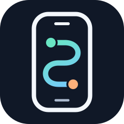

  

<h1 align="center">PalmRelay · 掌间接力</h1>

<strong>把任务交给手机，把结果交还给你。</strong>

Android 手机上的执行型 Agent · 产品与技术设计阶段

---

PalmRelay 希望让你用一句话，指挥 Agent 操作手机上已经登录的 App：读取信息、办理已有服务、跨 App 整理结果，并随时暂停或接管。

核心体验是：**说清目标 → 顺畅交接 → 看懂进度 → 随时接管 → 从中断处继续 → 拿到可核对的结果。**

用户不必把目标翻译成点击步骤，也不应该承担寻找端口、猜测卡顿原因、反复重述任务等额外工作。产品围绕这条完整链路设计。

## 当前状态

**本仓库只有设计文档和原创 SVG 品牌素材，没有 App、可运行 Agent、安装包或已发布 SDK。** 文中的接口、模块和阶段目标均为提案。

连接可靠性、跨机型兼容性和完整用户体验均待验证。公开示例使用独立构造的通用场景，不能作为已支持某个第三方 App 的承诺。

## 产品主张

- **已有 App，已有登录状态**：围绕真实手机上的界面办事。
- **看清再操作，操作后验证**：优先元素定位，必要时使用最新截图。
- **你始终能接回手机**：浮窗与通知准确触达，暂停、接管和恢复有明确状态。
- **结果带依据**：完成、部分完成、仍在处理和无法确认分别报告。
- **少一次折返，少一次重述**：从连接到恢复都保留目标与已完成进度。

## 文档导航

| 文档 | 回答的问题 |
| --- | --- |
| [产品设计](docs/01-product.md) | 为谁做、解决什么问题、首版边界是什么？ |
| [架构设计](docs/02-architecture.md) | Android、设备驱动与 Agent 如何协作？ |
| [工具协议草案](docs/03-tool-contract.md) | Agent 能做什么，如何定位、取消和判断结果？ |
| [交互设计](docs/04-experience.md) | 从表达目标到拿回结果，怎样减少等待、打断和来回切换？ |
| [迭代与验收](docs/05-roadmap.md) | 分几步交付，什么证据算完成？ |
| [设计决策与待验证项](docs/06-decisions.md) | 已选择什么，哪些问题必须先验证？ |
| [品牌与 Logo](docs/07-brand.md) | 名称、标识、颜色与应用方式是什么？ |

## 建议路线

1. **链路原型与连接验证**：走通首次使用和再次使用，验证配对、后台执行与恢复。
2. **通用工具**：打开、观察、点击、滑动、输入与结果验证。
3. **可用体验**：会话独占、任务卡、暂停与接管。
4. **端到端打磨**：通过通用任务验证表达、交接、等待、纠偏与结果交付。
5. **扩展能力**：降低启用门槛，再做跨 App 工作流。

先用技术验证确定实现路线，再估算工期；不把未来能力写成当前功能。

## 与 AndChamber 的关系

方案源自 AndChamber 内的手机操控探索。PalmRelay 将其整理为独立产品设计，建议以 AndChamber 作为首个 Agent 宿主集成对象，同时保持设备控制协议与具体聊天 UI 解耦。

本仓库没有复制 AndChamber 的代码，也没有选择独立打包完整 Agent 运行时。首版宿主集成、后续独立 App 的范围见[架构设计](docs/02-architecture.md)。

## 参与设计

目前适合讨论：产品流程、设备兼容性、工具契约、验收场景与品牌方向。实现前应先完成 P0 技术验证，并更新对应设计决策。

公开样例独立构造；未经明确同意，不将用户聊天中的经历、任务或操作记录改写成案例。账户、订单、配对密钥、真实设备截图和运行日志不进入公开仓库。
